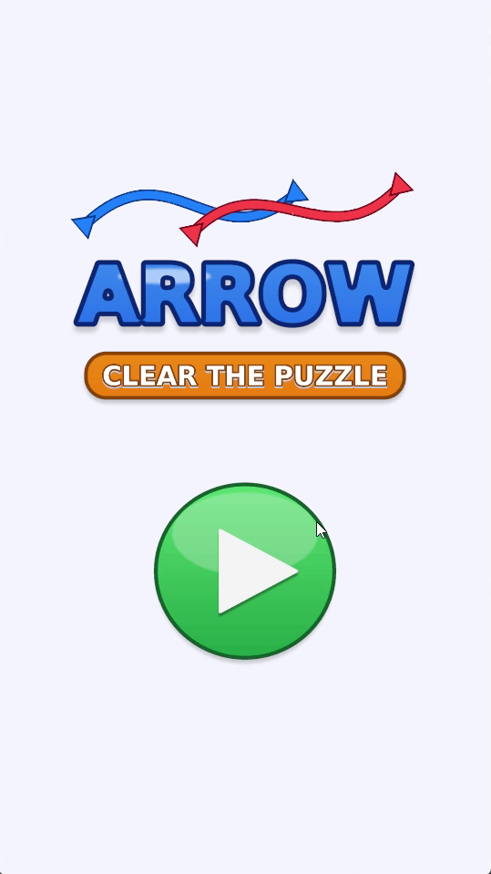
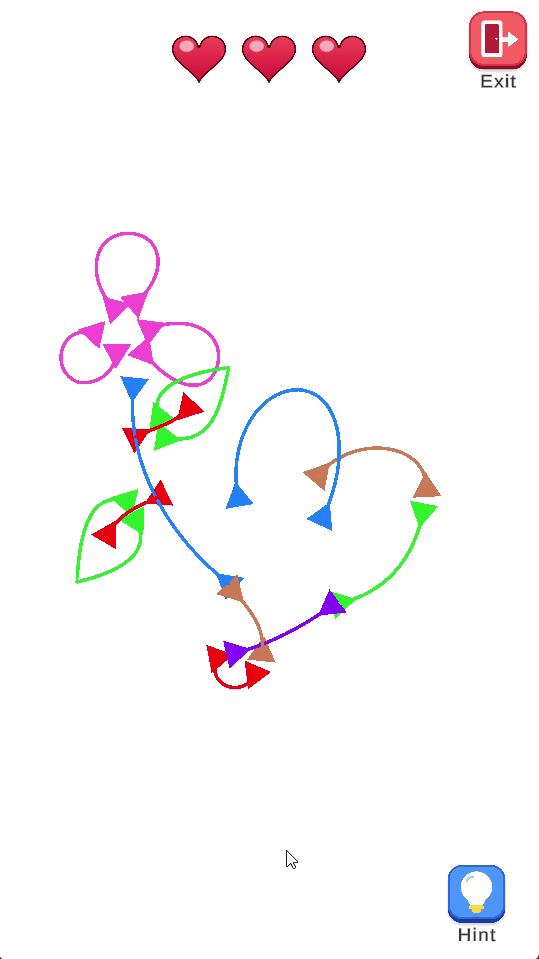
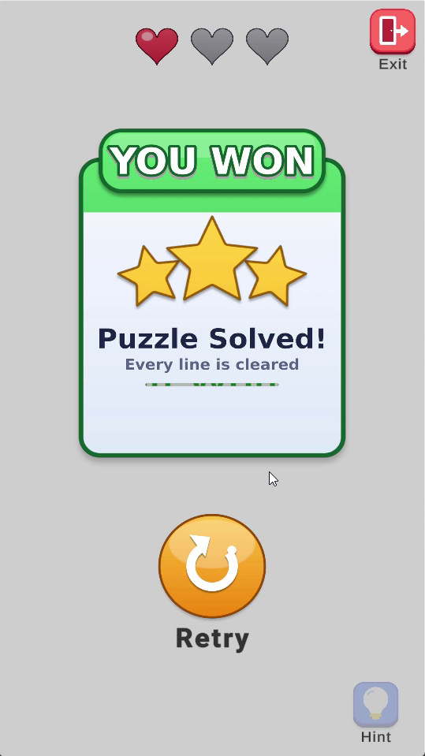
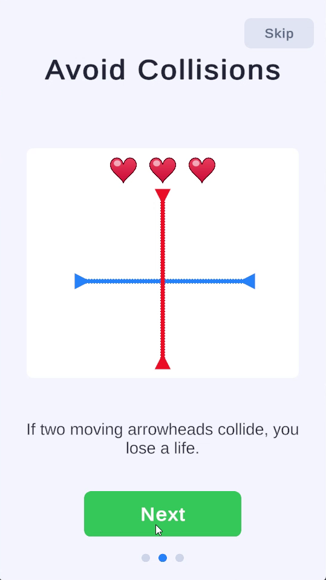
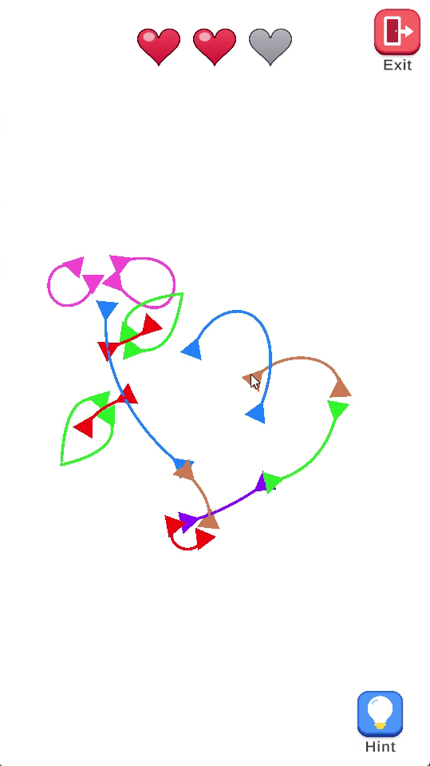
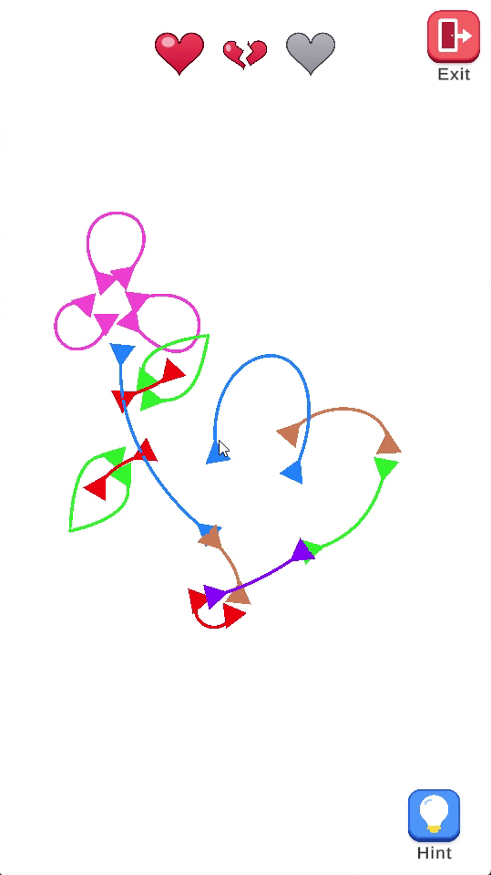
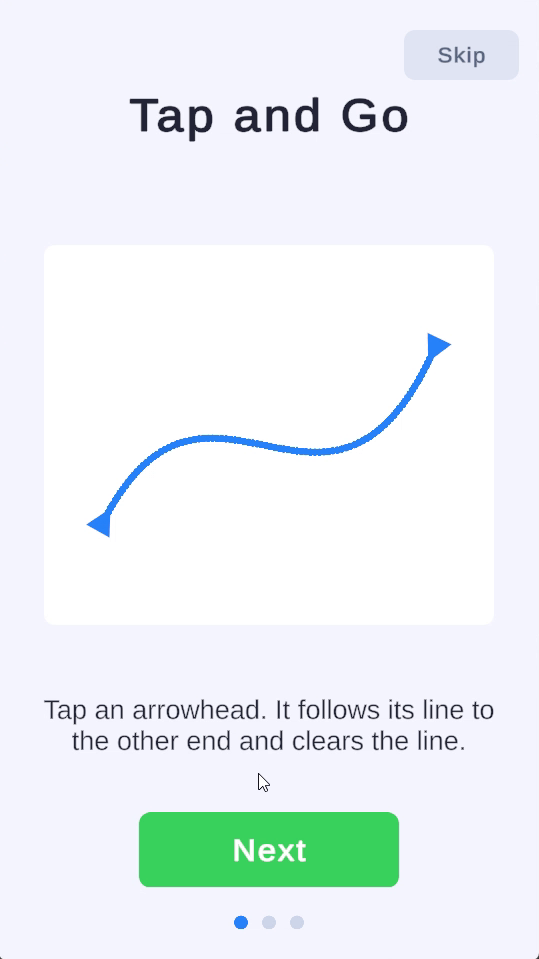
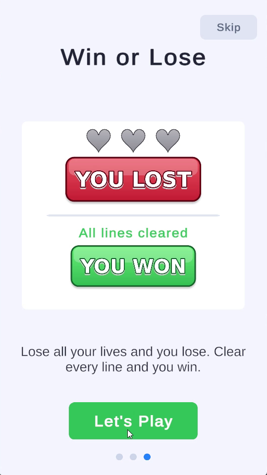
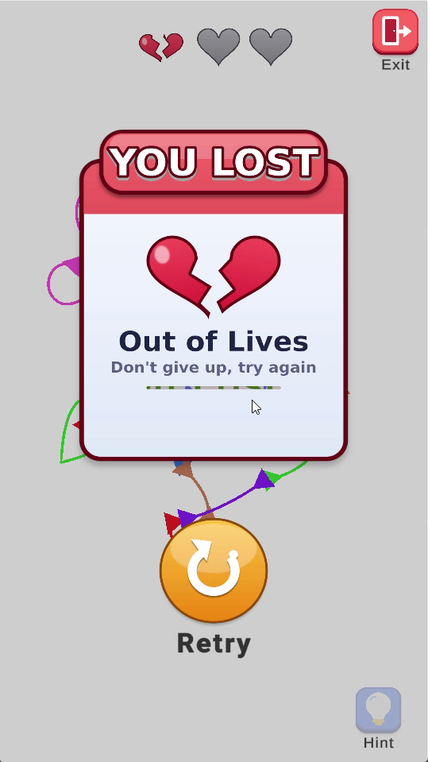

# Arrows: Clear the Puzzle

A fast puzzle game about **timing and order**, made in **Unity 6** for portrait screens.

The board is covered with tangled coloured lines. Each line has an arrowhead at both ends. Tap one arrowhead and it travels along its own line to the opposite end, and the line disappears. The catch: two arrowheads that are moving at the same time must never touch.

  
  
  

## The idea

Most puzzle games ask *where* to put something. This one asks ***when***. The lines never move, and they are allowed to cross and overlap, so the board itself is never the danger. The only thing that can go wrong is timing: two arrowheads in the same spot while both are moving.

That turns every tap into a small decision. Which arrowhead do I send, and is anything about to pass through the same area? Clear a safe line first and a tricky one gets easier. Clear the wrong one first and a later line gets harder. The puzzle is solved by **choosing the right order**, not by fast reflexes, because every arrowhead moves at the same steady speed and you can predict where it will be.

## How it plays

1. **Tap an arrowhead.** It follows its line, and the part of the line it has passed disappears behind it.
2. **Keep going while it runs.** You can start other lines at any time. Starting many at once is fast but risky, and starting one at a time is slow but safe.
3. **A line finishes.** Both arrowheads and the whole line vanish.
4. **Two moving arrowheads touch.** You lose a life, and both of those lines snap back to where they started. Lines you already cleared stay cleared.
5. **Clear every line to win.** You have 3 lives. If they run out, the level is lost, and Retry starts it again.

The two arrowheads of a line are linked: once one of them is moving, the other is locked until the line finishes or resets.

  
  
  

## What makes it work

- **Easy to learn.** The whole game fits in one sentence, and the animated tutorial shows it in three short pages.
- **Mistakes are cheap and clear.** A collision breaks one heart and resets only the two lines involved, so you see exactly what clashed. Nothing you cleared is lost, so you want to try again.
- **The board gets easier as you play.** Every cleared line removes a possible conflict, so each level starts tense and ends relaxed.
- **Crowded corners create the challenge.** In the first level the three pink loops and the two leaf shapes have arrowheads sitting right next to each other. Starting two of them together causes an instant collision, so you learn to wait for one to move away first.
- **Short rounds.** A level takes around half a minute, so a loss feels like one more try rather than a setback.

## The Hint button

If you're stuck, press **Hint**. The game checks every line ahead of time, using the same movement and collision rules as the real game, and highlights one line that can be finished right now without any collision. Press it again and it may pick the same line or a different one. Hints are unlimited and only appear when you ask. They show a safe next move, not the full solution.

## Game feel

Lines are smooth curves, and arrowheads turn to follow them. A small burst plays when a line is cleared. Hearts crack and break when a life is lost. The hinted line pulses so it is easy to spot.

  
  
  

## Levels are data

Each level is a data asset: a list of lines, each with a colour and curve points. The game code never depends on a specific level, so a new level is just a new asset (**Create -> Arrows -> Level Data**) dropped into the `LevelLoader`.

## Run it

1. Open the project in **Unity 6000.2.13f1**.
2. Open `Assets/Scenes/Game`, set the Game view to 9:16 and press Play.

A Windows build is provided separately.
